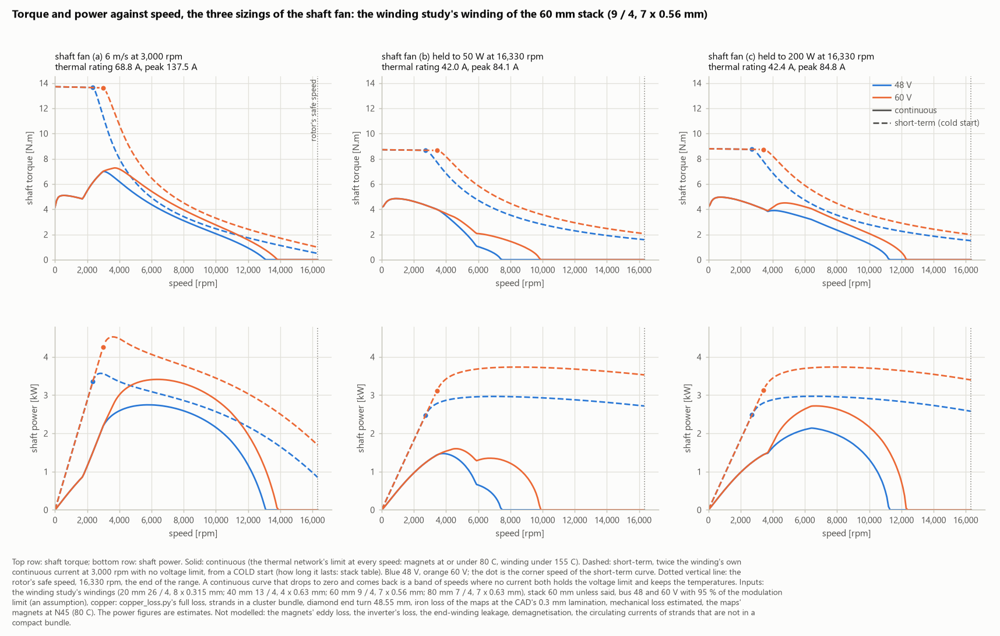
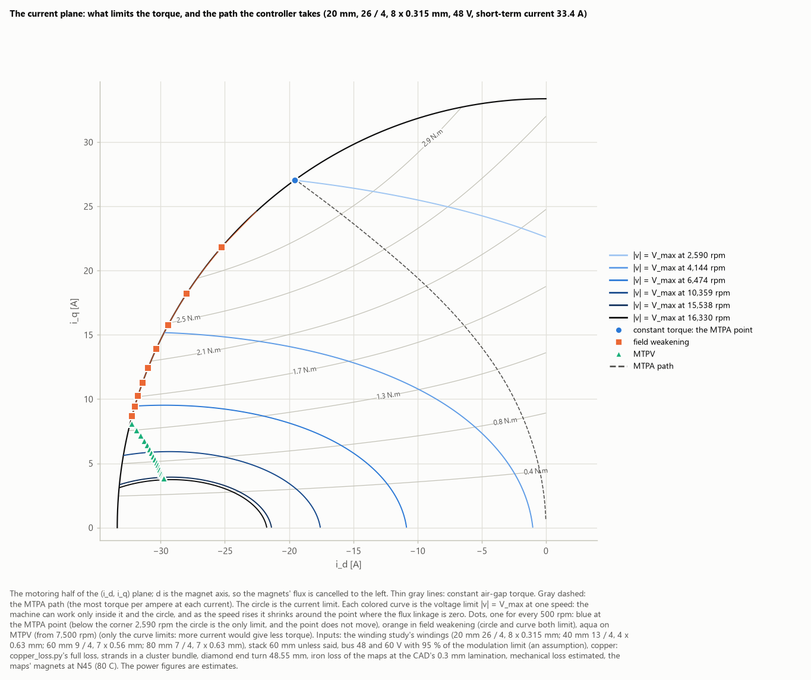
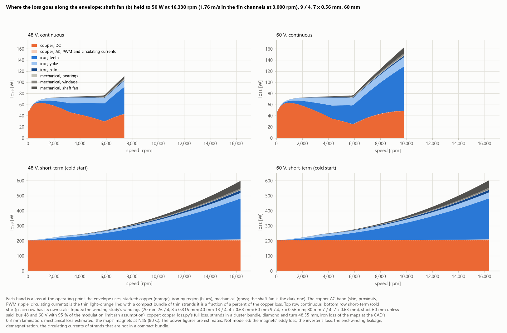
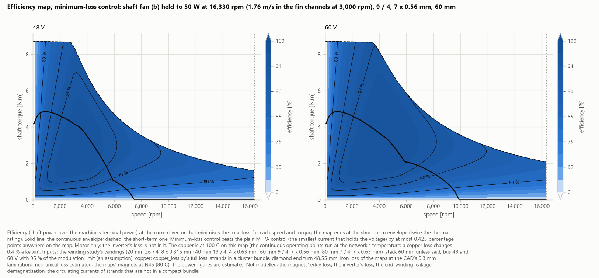
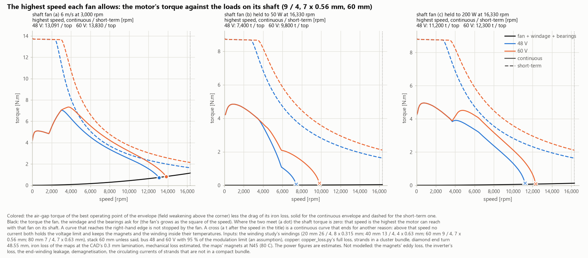
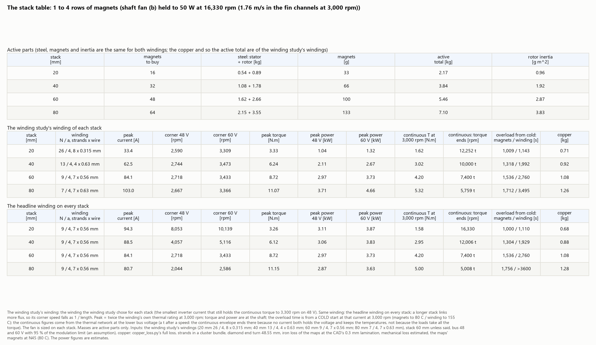
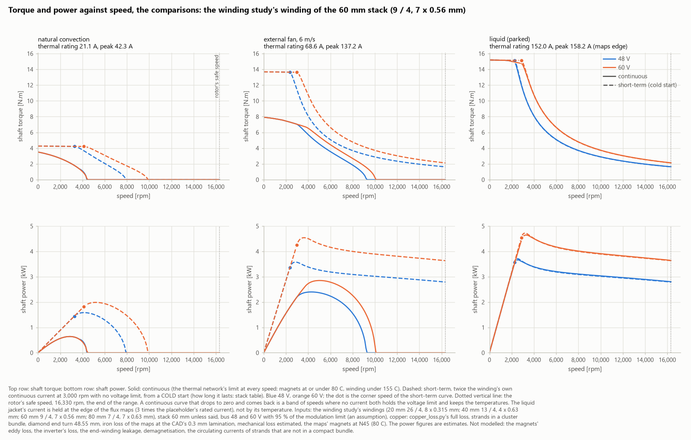

# Motor map: what the optimized motor can do

> **These are estimates, not measurements.**
> - **The chain:** every number comes from 2D finite-element flux maps of the optimized cross-section (FEMM 5.0), then a loss model, then a thermal network. Each link is checked against an independent route (§10).
> - **Nothing has been measured on hardware yet.** §10 lists what isn't modelled.
> - **The code:** the Python that produced these numbers is in [`python/`](python/), mainly `optimization/motor_map*.py` and `optimization/short_circuit.py` ([guide](python/README.md)). The flux maps themselves are in [`matlab/maps/`](matlab/maps/).
>
> *Computed 2026-11-09.*

## The motor

| | |
|---|---|
| Topology | PM-assisted synchronous reluctance: 36 slots, 8 poles, two N45 magnets per pole in a V |
| Stator | outer diameter 128 mm, bore 91.6 mm. Optimized slots: opening 1.5 mm, tooth 3.0 mm, yoke 4.16 mm |
| Rotor | outer diameter 90 mm (air gap 0.8 mm), shaft Ø15 mm. Optimized: outer bridge 1.4 mm, centre rib 1.0 mm, V angle 111° |
| Stack | **60 mm**: three rows of 20 mm magnets, 48 magnets of 1.57 × 9.08 × 19.14 mm (100 g) |
| Steel | M-19, 0.3 mm laminations |
| Winding | **9 turns a coil side, 4 parallel paths, 7 strands of 0.56 mm** in a compact bundle. Slot fill 0.428, 19.26 mΩ a phase at 100 °C |
| Supply | a **48 V** DC bus (60 V shown alongside), using 95 % of the modulation limit |
| Cooling | a **fan on the shaft** blowing over a finned housing, like a simple industrial motor. Three fan sizes are compared (§1) |
| Limits | the N45 magnets at 80 °C, the winding at 155 °C (class F), 40 °C ambient. **The speed range ends at 16,330 rpm**, the optimized rotor's safe speed (half the steel's yield stress, at 1.2 × overspeed, on placeholder strength values) |
| Masses | steel 1.62 kg (stator) + 2.66 kg (rotor), copper 1.08 kg, magnets 0.10 kg: **5.46 kg of active parts**. Rotor inertia 2.87 g·m² |

**Against the starting design** (the first-pass geometry without its air band), at the same copper loss, the optimized cross-section makes **60 % more torque**, with 4.8 % torque ripple instead of 18.5 %.

## 1. The capabilities

How much torque and power the motor gives:
- **continuously**, which is set by the heat;
- **for a short time**, at twice the continuous current, from a cold start.

The three fan sizes:
- **fan (a)** is sized like an industrial motor's, for 6 m/s of air at 3,000 rpm;
- **fans (b) and (c)** are held to 50 W and 200 W of their own power at 16,330 rpm.

A fan on the shaft takes power that grows as the cube of the speed, so its size is a trade (§6).

**At 48 V (60 V in brackets).** All torques and powers are at the shaft, after the iron drag, the bearings, the windage and the fan.

| | Fan (a): 6 m/s at 3,000 rpm | Fan (b): 50 W at the top | Fan (c): 200 W at the top |
|---|---|---|---|
| Continuous torque at 3,000 rpm | 7.00 N·m | 4.20 N·m | 4.23 N·m |
| Continuous power at 3,000 rpm | 2.20 kW | 1.32 kW | 1.33 kW |
| Most continuous power | 2.75 kW at 5,800 rpm (3.41) | 1.47 kW at 3,800 rpm (1.60) | 2.14 kW at 6,400 rpm (2.72) |
| Continuous up to | 13,091 rpm (13,830) | 7,400 rpm (9,800) | 11,200 rpm (12,300) |
| Short-term current (peak, a phase) | 137.5 A | 84.1 A | 84.8 A |
| Short-term torque | 13.6 N·m to 2,350 rpm (to 2,983) | 8.67 N·m to 2,718 rpm (to 3,433) | 8.75 N·m to 2,711 rpm (to 3,425) |
| Short-term peak power | 3.57 kW (4.53) | 2.97 kW (3.74) | 2.97 kW (3.74) |
| Short-term at 16,330 rpm | 0.50 N·m = 0.85 kW (1.70) | 1.59 N·m = 2.72 kW (3.53) | 1.51 N·m = 2.58 kW (3.40) |
| How long the short-term lasts, from cold | 7.6 min (the winding reaches 155 °C) | 26 min (the magnets reach 80 °C) | 25 min (the magnets) |
| Best efficiency (motor only) | 93.8 % | 95.2 % (95.4) | 95.1 % (95.2) |

**The speed band, in numbers.** Fans (b) and (c), torque in N·m and power in kW, 48 V; 0 where the envelope has ended:

| Speed | 1,000 rpm | 3,000 rpm | 6,000 rpm | 10,000 rpm | 16,330 rpm |
|---|---|---|---|---|---|
| (b) continuous | 4.84 / 0.51 | 4.20 / 1.32 | 1.04 / 0.65 | 0 | 0 |
| (b) short-term | 8.70 / 0.91 | 8.43 / 2.65 | 4.71 / 2.96 | 2.80 / 2.93 | 1.59 / 2.72 |
| (b) short-term loss, and efficiency | 212 W, 81 % | 236 W, 92 % | 273 W, 92 % | 363 W, 89 % | 600 W, 82 % |
| (c) continuous | 4.94 / 0.52 | 4.23 / 1.33 | 3.34 / 2.10 | 1.26 / 1.32 | 0 |
| (c) short-term | 8.77 / 0.92 | 8.49 / 2.67 | 4.72 / 2.97 | 2.78 / 2.91 | 1.51 / 2.58 |

**On 60 V** the corner speeds rise by about a quarter, and so does the power above them. For example, fan (b)'s short-term power is 3.69 kW at 6,000 rpm and 3.53 kW at 16,330 rpm.

## 2. Torque and power against speed

*Shaft torque (top) and power (bottom) against speed, continuous (solid) and short-term (dashed), on 48 V (blue) and 60 V (orange). The dot is the short-term curve's corner speed. The dotted line is the rotor's safe speed, the end of the range.*

**The three regions of each curve:**
1. **Constant torque, up to the corner speed.** The current limit sets the torque, at the current angle that gives the most torque per amp (MTPA).
2. **Field weakening.** At the corner, the voltage the motor needs reaches what the bus can make: 0.95 × 48 V / √3 = 26.3 V peak a phase. Above it, the controller turns the current toward −d to cancel part of the magnets' flux. The torque falls roughly as 1/speed, and the power stays nearly flat.
3. **The voltage-limited region (MTPV).** When more current no longer helps, the best point lies on the voltage limit alone.

*How the controller moves the current vector as the speed rises:*
- *it starts at the MTPA point on the current circle (blue);*
- *it slides along the circle toward −d as the voltage ellipses shrink (field weakening, orange);*
- *then it follows the voltage limit alone (MTPV, aqua).*

*Shown for the 20 mm stack's winding, where all three regions are visible.*

**Why fans (b) and (c) keep their power to the top speed.**
- The flux maps give this motor a **characteristic current** of 84.2 A for this winding. That's the d current that cancels the magnets' flux entirely.
- Fans (b) and (c) set the short-term current at 84.1 and 84.8 A, the same value. That's the textbook condition for a power curve that stays flat as the speed rises without limit.
- So at 16,330 rpm the short-term power is still 92 % of its peak on 48 V.
- This wasn't designed for: it's where the cooling's rating happened to land.

**Fan (a) is different.** Its current is higher (137.5 A), so the motor reaches MTPV. Its fan's own load also grows to 1.9 kW at the top, so its power falls with speed.

## 3. Where the loss goes

*Each loss at the operating point the envelope uses, stacked: copper (orange), iron by region (blues), mechanical (grays; the fan is the dark band). Fan (b), continuous (top) and short-term (bottom), 48 V and 60 V.*

| Fan (b), 48 V | Copper (of it AC) | Iron: teeth, yoke, rotor | Bearings, windage, fan | Total |
|---|---|---|---|---|
| Continuous, 3,000 rpm | 48.7 W (0.1) | 14.8, 9.1, 0.5 W | 0.4, 0.2, 0.3 W | **74 W** |
| Short-term, 3,000 rpm | 204.5 W (0.3) | 19.3, 10.7, 1.0 W | 0.4, 0.2, 0.3 W | **236 W** |
| Short-term, 16,330 rpm | 210.7 W (6.5) | 271.7, 37.3, 17.0 W | 2.3, 11.0, 50.0 W | **600 W** |

- **At low speed the copper dominates.**
- **At high speed the teeth's iron loss takes over:** 45 % of the total at 16,330 rpm.
- **The AC part of the copper loss is small** with thin strands bundled together: skin, proximity, the PWM ripple and the current circulating between parallel strands add 3 % at the top speed. Spread over the slot's depth, the same strands would lose about 20 % more copper at 10,000 rpm, mostly to circulating current.
- **The continuous curves follow the heat.** As the iron loss grows with speed, less room is left for copper, so the continuous current falls.
  - Above a certain speed, even the field-weakening current needed at zero torque overheats the motor. That's where the continuous curves end.
  - A small fan's air stays laminar in the fins until fairly high speeds, and laminar flow cools poorly. Fan (b)'s air starts to leave laminar flow near 5,900 rpm, which makes the kink in its curves there.

## 4. Efficiency

*Efficiency (shaft power over the terminal power) at the current vector that minimises the total loss for each speed and torque, up to the short-term envelope. The solid line is the continuous envelope. The copper is held at 100 °C on this map. The inverter's loss isn't in it.*

- **Best:** 95.2 % at 3,746 rpm and 2.9 N·m on 48 V (95.4 % at 4,516 rpm and 3.4 N·m on 60 V).
- **Above 90 %** over 40 % of the map on 48 V and 53 % on 60 V.
- **MTPA control is enough for this motor.** Choosing the current for the least total loss instead of the least current saves at most 0.43 percentage points anywhere on the map.

## 5. How fast it can go with each fan

*The motor's torque against the loads on its own shaft. A dot marks where a fan's load ends the torque; a cross where the heat ends it.*

- **Every fan reaches 16,330 rpm short-term.**
- **Continuously:**
  - fan (a) stops at 13,091 rpm (13,830 on 60 V), where its own fan takes 0.73 of the motor's 0.87 N·m;
  - fans (b) and (c) are stopped by the heat, at 7,400 and 11,200 rpm (9,800 and 12,300 on 60 V).

## 6. The fan's size

A fan sized like an industrial motor's (fan (a)) takes 12 W at 3,000 rpm but 1,941 W at 16,330 rpm: about the cube of the speed ratio, 5.44³ = 161. Fan (b) takes 0.3 W and 50 W.

| | (a) | (b) | (c) |
|---|---|---|---|
| The fan's power at 3,000 / 10,000 / 16,330 rpm | 12 / 449 / 1,941 W | 0.3 / 12 / 50 W | 1.2 / 46 / 200 W |
| Continuous torque at 3,000 rpm | 7.00 N·m | 4.20 N·m | 4.23 N·m |
| Continuous power at 6,000 / 10,000 rpm | 2.75 / 2.16 kW | 0.65 / 0 kW | 2.10 / 1.32 kW |

**What each size gives and costs:**
- **(a)** has the most continuous torque at low and middle speed. To use it fully it needs a larger inverter (69 A continuous, 137 A short-term), and at the top its fan takes more power than the motor delivers there.
- **(b)** is the most efficient, but runs continuously only to 7,400 rpm.
- **(c)** has (b)'s low-speed rating and inverter current, and runs continuously to 11,200 rpm. It costs 5 % of the short-term torque at the very top.

**The choice is still open.** Below about 800 W at the top, a shaft fan's air stays laminar at 3,000 rpm, so all the small fans give nearly the same low-speed rating.

## 7. Against the stack length

*Each stack carries its own winding (the winding study's pick for it), so the corner speed on 48 V stays at about 2,700 rpm.*

Fan (b), 48 V:

| Stack | Winding (turns / paths, strands × wire) | Short-term current | Peak torque | Peak power, 48 V (60 V) | Continuous torque at 3,000 rpm | Continuous up to | Active mass |
|---|---|---|---|---|---|---|---|
| 20 mm | 26 / 4, 8 × 0.315 mm | 33.4 A | 3.33 N·m | 1.04 kW (1.32) | 1.62 N·m | 12,252 rpm | 2.17 kg |
| 40 mm | 13 / 4, 4 × 0.63 mm | 62.5 A | 6.24 N·m | 2.11 kW (2.67) | 3.02 N·m | 10,000 rpm | 3.84 kg |
| 60 mm | 9 / 4, 7 × 0.56 mm | 84.1 A | 8.72 N·m | 2.97 kW (3.73) | 4.20 N·m | 7,400 rpm | 5.46 kg |
| 80 mm | 7 / 4, 7 × 0.63 mm | 103.0 A | 11.07 N·m | 3.71 kW (4.66) | 5.32 N·m | 5,759 rpm | 7.10 kg |

**Every row of magnets adds torque and power in proportion.** It also adds inverter current: a longer stack links more flux per turn, so fewer turns fit the same bus voltage at the same corner speed.

## 8. Against the winding and the magnet grade

The winding was chosen by checking every winding that fits the slot (20,316 of them) against the heat and every copper loss: the smallest inverter current that holds the continuous torque to 3,300 rpm on 48 V. Its neighbours on the trade-off front, on 60 mm with fan (b) at 48 V:

| Winding | Short-term current | Corner speed | Torque at 10,000 rpm | Power at 16,330 rpm | Continuous up to |
|---|---|---|---|---|---|
| **9 / 4, 7 × 0.56 mm** | 84.1 A | 2,718 rpm | 2.80 N·m | 2.72 kW | 7,400 rpm |
| 8 / 4, 4 × 0.8 mm | 96.1 A | 3,067 rpm | 3.21 N·m | 3.16 kW | 8,900 rpm |
| 5 / 4, 8 × 0.71 mm | 152.4 A | 4,999 rpm | 5.18 N·m | 5.32 kW | 11,900 rpm |
| 4 / 4, 8 × 0.8 mm | 191.6 A | 6,277 rpm | 6.41 N·m | 6.76 kW | 12,802 rpm |
| 3 / 4, 8 × 0.9 mm | 248.8 A | 8,468 rpm | 7.92 N·m | 8.85 kW | 13,400 rpm |

**All of them hold about 4.2 N·m continuously at 3,000 rpm.** Fewer turns buy corner speed and power at speed, paid for in inverter current.

**A 150 °C magnet grade** (an SH grade, the same size) hands the limit from the magnets to the winding. With the 8 / 4, 4 × 0.8 mm winding and fan (b):
- 7.43 N·m continuous at 3,000 rpm, against 4.27 with N45;
- continuous running to 16,330 rpm (2.89 kW there on 48 V);
- 14.2 N·m short-term, at 163 A.

The flux maps are N45's, and a hotter grade has less remanence, so these overstate its torque by a few per cent.

## 9. With other coolings

*The same motor in still air, with an external fan blowing 6 m/s at every speed, and with a liquid jacket (not planned for now).*

| 48 V | Natural convection | External fan, 6 m/s | Liquid jacket |
|---|---|---|---|
| Continuous torque at 3,000 rpm | 2.03 N·m | 7.02 N·m | 11.40 N·m (14.56 on 60 V) |
| Continuous up to | 4,318 rpm | 9,201 rpm | 16,330 rpm |
| Short-term torque | 4.22 N·m (42 A) | 13.6 N·m (137 A) | 15.1 N·m (158 A) |
| Short-term peak power | 1.59 kW | 3.58 kW | 3.72 kW (4.73 on 60 V) |

The liquid jacket's current is held at the flux maps' edge (158 A for this winding), so its short-term and continuous curves nearly coincide.

## 10. What the numbers rest on, and what they leave out

**The chain:**
1. **Flux maps** of the optimized cross-section: ψ_d and ψ_q over the current plane, up to 3 × the rated current and into field weakening. That's 425 operating points, each averaged over the rotor positions of a ripple period, solved on FEMM 5.0's fine mesh, with cross-saturation included. The d-q torque from the maps matches FEMM's own torque to 0.085 %. *Their tables, with scripts for Simscape's FEM-Parameterized PMSM block, are in [`matlab/maps/`](matlab/maps/), validated in MATLAB (2026-11-11). The Simulink block is the next step.*
2. **The limits.** The winding scales the maps (ψ ∝ turns, the current ∝ 1/turns, everything ∝ the stack length). Then come the current limit and the voltage limit, and MTPA, field weakening and MTPV, solved at every speed.
3. **The losses:**
   - the copper: DC with the end turns, plus skin, proximity, PWM ripple and circulating currents;
   - the iron: a Bertotti model fitted to M-19 and applied to each element's flux-density waveform from FEMM;
   - the bearings, the windage and the fan, as estimates.
4. **The heat.** A lumped thermal network of 11 parts sets the continuous current at each speed. It was calibrated against exact solutions and agrees with a 2D finite-element slice of the stator within 2 % (FEMM and CalculiX).

**The checks** (21 in the run, all passing, with each limit written before the run):
- below the corner, the torque equals the MTPA path's at the current limit, to 2 × 10⁻⁸;
- the energy balance (input = output + every loss) closes at all 43,493 operating points, to 10⁻¹⁵;
- the MTPV points meet their optimality condition, to 10⁻⁸;
- FEMM, re-run at three deep field-weakening points, reproduces the maps' flux linkages within 0.016 %;
- the winding study's own 120 torques are reproduced within 0.005 N·m.

**What isn't modelled, or rests on an assumption:**
- **The magnets' temperature.** Their strength is N45's at 20 °C. At their 80 °C limit, N45's remanence is 7.2 % lower (−0.12 %/°C, from the maker's datasheet). That lowers the torque per amp and the back-EMF by a few per cent, which also makes the voltage limit easier.
- **Demagnetisation isn't checked yet.** The deepest d currents on these envelopes are −83 A (fans (b), (c)) and −125 A (fan (a)).
- **The magnets' eddy loss, the inverter's loss, and the end-winding leakage inductance** aren't included. The flux maps are 2D, so the corner speeds are slightly optimistic.
- **The voltage margin** (95 % of the modulation limit) is an assumption. The mechanical losses are good to a factor of two.
- **The housing, the shaft and the bearings** aren't designed yet. The thermal network uses placeholders for them, moved across their ranges in a sensitivity study.
- **The iron loss** is fitted to M-19 data within 6.5 % rms. Skin effect in the laminations above 2 kHz isn't modelled, so the top-speed iron loss reads 1–7 % high.
- **The flux maps end at 158 A** for this winding. Nothing beyond that is computed.

## 11. Protection at speed

The magnets make a voltage whenever the rotor turns, controlled or not.
- **On a 48 V bus,** their line-to-line peak passes the bus above **4,049 rpm** (5,061 rpm on 60 V). At 16,330 rpm it reaches **194 V**, four times the bus.
- **Above that speed, the inverter must hold a field-weakening current at every operating point,** even at zero torque. If its switching stops there, the motor drives current back through the inverter's diodes and charges the bus ("uncontrolled generation").

**The usual protection is an active short circuit:** the three low-side switches close together, and the motor's own flux sets the current. From the flux maps:
- **The steady current is 84.2 A at high speed** (the characteristic current), the same as the short-term current the inverter already carries.
- **The braking torque is small:** 0.12 N·m at 16,330 rpm, 0.65 N·m at 3,000 rpm and 4.2 N·m at 300 rpm. All of the shaft power goes into the copper: about 205 W above 2,000 rpm.

**Still to check:**
- the current's overshoot at the instant of the short (up to about twice), against the magnets' demagnetisation and the switches' ratings;
- the case where the battery is disconnected.

## 12. Decisions still open

These move the numbers above:
- **the fan's size** (§6);
- **the magnet grade** (§8);
- **the stack length** (§7);
- **the winding and its inverter class** (§8);
- **the protection at speed** (§11).

Each change is a re-run of the same chain, not new modelling.

## Files

- **This page's figures:** [`docs/figures/motor-map/`](docs/figures/motor-map/).
- **The code:** [`python/optimization/`](python/optimization/): `motor_map.py` (the engine), `motor_map_thermal.py` (the thermal limits at every speed), `motor_map_stack.py` (the stacks), `motor_map_run.py` (the run and its 21 checks), `motor_map_figures.py` (the figures) and `short_circuit.py` (§11).
- **The flux maps,** with their own figures in [`docs/figures/maps/`](docs/figures/maps/) and the MATLAB tables and scripts in [`matlab/maps/`](matlab/maps/).
