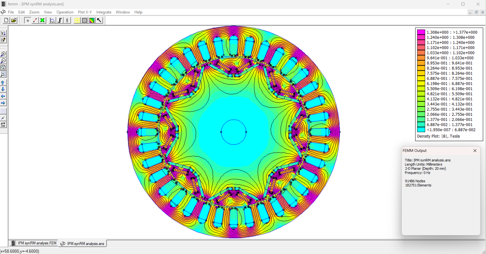

# IPM synRM: an open motor design

A **36-slot, 8-pole permanent-magnet-assisted synchronous reluctance motor** (PMaSynRM), with two N45 magnets per pole in a V, M-19 steel, a 90 mm rotor and a 128 mm stator. It is being designed, simulated and optimized with open tools, and documented as it goes, so that anyone can check and reuse each step.

> **Where it stands (2026-11-05).** This repository holds the **first pass** (February to April 2026): the SolidWorks geometry, the FEMM model and its rotor sweep, the flux-linkage extraction in MATLAB, and a first FOC plant in Simulink. A new pipeline (Python geometry → FEMM 5.0 → an NSGA-II optimizer, with Elmer, CalculiX and ROSS for verification) is being built and validated in a separate workspace. Its results arrive here stage by stage, as each one is finished.

## The motor

| | |
|---|---|
| Topology | PM-assisted synchronous reluctance, interior V magnets, two per pole |
| Slots / poles | 36 / 8, double-layer distributed winding, q = 1.5 slots per pole per phase, winding factor 0.945 |
| Stator | outer diameter 128 mm, bore 91.6 mm |
| Rotor | outer diameter 90 mm (air gap 0.8 mm), shaft Ø15 mm |
| Magnets | N45 sintered NdFeB, 1.57 × 9.08 × 19.14 mm (the first dimension along the magnetization) |
| Steel | M-19 non-oriented electrical steel |
| Axis convention | d = the magnet axis, so L_d < L_q |

## Status

✅ done · 🟡 partly done · ⬜ planned

| Stage | Status | What exists |
|---|---|---|
| Geometry (CAD) | ✅ first pass | SolidWorks parts, assembly and drawings (`cad/`) |
| 2D magnetostatic FEA | ✅ first pass | The FEMM model, about 91,000 nodes; a rotor sweep from 5° to 90° mechanical; peak tooth flux density about 1.3 T (`femm/`) |
| Flux linkage and d-q parameters | 🟡 | The flux linkage from FEMM, extracted in MATLAB (`matlab/flux_linkage.mlx`). The plant's L_q of 11.2 mH turned out to be the magnet flux divided by the 1 A test current, not an inductance; FEMM puts the saliency L_q / L_d at about 1.8. The corrected parameters come with the new pipeline |
| FOC plant in Simulink | 🟡 | `matlab/simulink/Improved_plant.slx` runs a speed-controlled FOC, unloaded, with constant motor parameters. `Plant_model.slx` was the first attempt, on Simulink's default block values |
| The six model-fidelity items (saturation, field harmonics, hysteresis, proximity and high-frequency losses, D/L/air-gap scaling) | ⬜ | In the new pipeline |
| Geometry optimization (NSGA-II) | ⬜ | In the new pipeline |
| Structural and thermal checks | ⬜ | Planned: CalculiX for stress and vibration modes, ROSS for rotor dynamics |
| Inverter | ⬜ | Planned |

## What's here

| Folder | Contents |
|---|---|
| `femm/` | The reference FEMM model, `IPM synRM analysis.FEM`, and two earlier models; `femm/screenshots/` has the rotor sweep and the phase-A plots |
| `matlab/` | `flux_linkage.mlx` with its results; `transforms/` has the six Clarke and Park transforms; `simulink/` has the two plant models |
| `cad/` | SolidWorks parts, the assembly, the drawings and the equation files |
| `docs/figures/` | Screenshots of the first pass: the FEMM model and its solution, the rotor and stator drawings, the Simulink plant and its scope |

FEMM's result files (`.ans`) aren't stored: FEMM regenerates them from the `.FEM` models. The repository's state before this reorganisation is tagged `v0`.

## Next steps

- **The geometry in Python**, so the optimizer can change it (one recipe writes FEMM's model, a DXF for CAD, and the meshes for Elmer and CalculiX).
- **FEMM 5.0 in the loop**: the torque, the flux linkages, the ripple and the air-gap harmonics of every candidate, at its own best current angle.
- **The six fidelity items**, and a **flux-map-driven plant** in Simulink in place of the constant parameters.
- **The structural checks** of the rotor's bridges at speed, and the rotor dynamics of the shaft.
- **An interactive flux page**: the rotor turning, its flux lines moving, and the design's choices shown with their numbers. It is published once it is refined.

## How it's made

Each step runs as a loop: set a goal, decide the step, test it in simulation, check the numbers, and change the decision when the results disagree. A decision stays a working assumption until a test backs it.

## License

[Apache-2.0](LICENSE)
