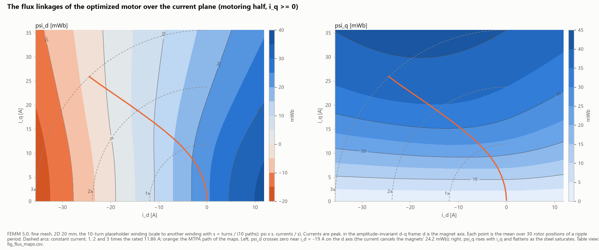
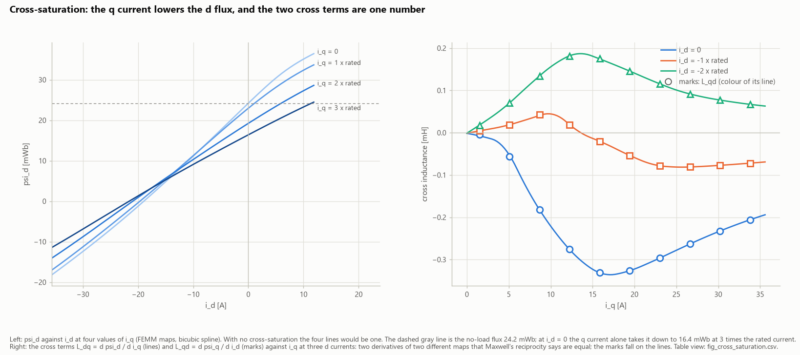
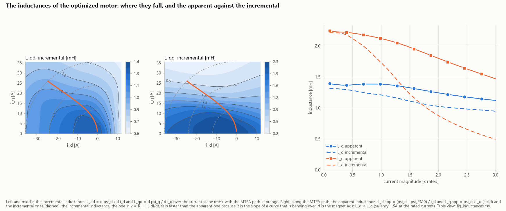
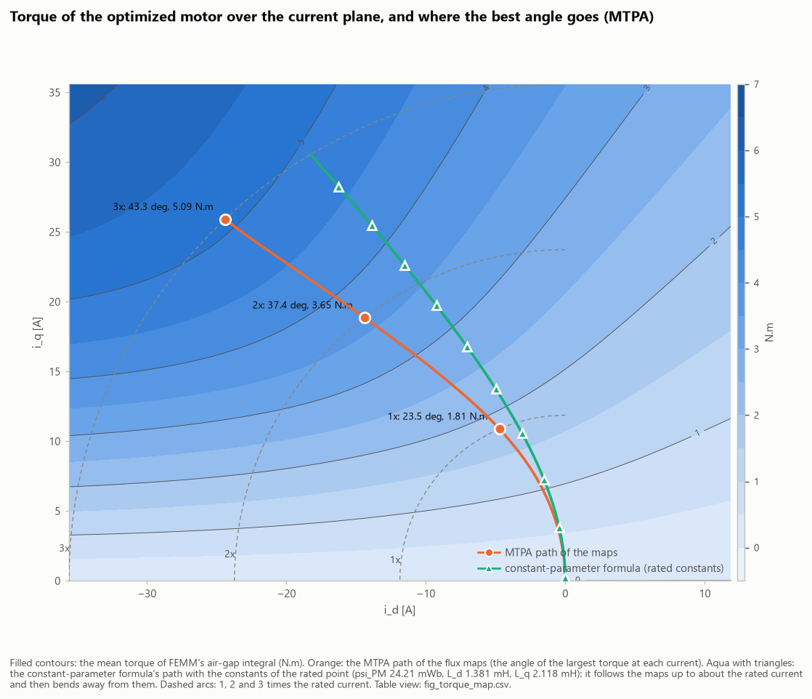
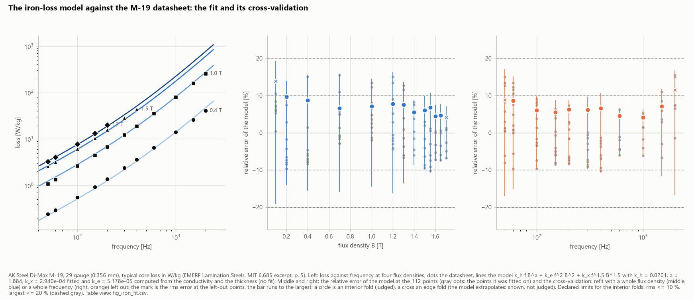
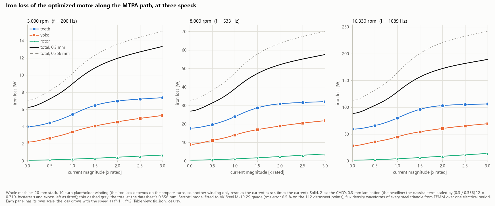

# Flux maps for MATLAB and Simulink

The optimized motor's flux maps, ψ_d and ψ_q over the whole current plane with cross-saturation included. They come in the form Simscape Electrical's **FEM-Parameterized PMSM** block takes, with scripts that scale them to a winding, build the MTPA table and fill the block.

> **Not run in MATLAB yet.**
> - The files were prepared from the maps' maths and MathWorks' documentation, and checked on the Python side by reading `fem_maps.mat` back.
> - The first MATLAB run is the validation pass. Start it with `check_fem_maps.m`.
> - The Python that wrote them is [`python/optimization/maps_matlab.py`](../../python/optimization/maps_matlab.py), named in the scripts' comments; the maps themselves come from [`maps_run.py`](../../python/optimization/maps_run.py) and [`maps_femm.py`](../../python/optimization/maps_femm.py).

## What the maps are

| | |
|---|---|
| Solver | FEMM 5.0, fine mesh (15,693 nodes), 2D, a **20 mm** stack |
| Winding | the 10-turn placeholder: 10 turns a coil side, one path, 120 series turns a phase (rescale it, below) |
| Grid | i_d from −3 to +1 × rated, i_q from −3 to +3 × rated, in steps of rated/4: **17 × 25 = 425 points**. Rated is 11.86 A peak (118.6 ampere-turns) |
| Each point | averaged over the rotor positions of the 60° electrical ripple period |
| Conventions | currents in A **peak**, amplitude-invariant d-q, **d = the magnet axis** (so L_d < L_q), Park's convention "Q leads D, rotor angle measured from A-phase to D-axis" |
| Resampling | the tables are resampled with a bicubic spline onto a 65 × 97 grid (rated/16), so the block's linear interpolation follows the spline within 0.2° and 0.02 % |
| The negative i_q half | solved in FEMM, not mirrored (the 36-slot, 8-pole winding isn't mirror-symmetric about d) |

**The checks the maps passed:**
- The d-q torque 1.5 p (ψ_d i_q − ψ_q i_d) from the maps matches FEMM's own air-gap torque at all 425 points, to 0.085 % at worst.
- The two cross inductances, L_dq = ∂ψ_d/∂i_q and L_qd = ∂ψ_q/∂i_d, are equal as reciprocity says they must be: median difference 0.015 %.

## Why the maps matter: cross-saturation

*ψ_d and ψ_q over the current plane. Straight, evenly spaced contours would mean constant inductances; the bending at high current is the saturation.*

*Left: ψ_d against i_d at four values of i_q. With no cross-saturation the four lines would be one: at i_d = 0, the q current alone pulls ψ_d from 24.2 down to 16.4 mWb at 3 × rated (20 mm, placeholder winding). Right: the two cross terms fall on one line.*

**What it does to the best current angle:**

| At | From the maps | A constant-parameter formula |
|---|---|---|
| 1 × rated | 23.5°, 1.81 N·m | 17.3° |
| 2 × rated | 37.4°, 3.65 N·m | 26.2° |
| 3 × rated | 43.3°, 5.09 N·m | 30.9°, and a torque 41 % too high |

A plant built on two constant inductances would promise torque the motor can't make. So the controller's MTPA table and the Simulink plant both come from the maps.

## The files

| File | What it does |
|---|---|
| `fem_maps.mat` | the tables, 1.35 MB, 48 variables: the two-sided flux tables, the torque table, a 2-D option (L_d, L_q, ψ_PM) and a 3-D option (ψ_d, ψ_q and T over 0–30° mechanical), the Steinmetz iron-loss tables, FEMM's raw tables, and the numbers a MATLAB run must reproduce |
| `fem_maps_setup.m` | loads the maps, scales them to a winding, plots them, builds the MTPA table and, optionally, fills the block (run it section by section) |
| `scale_maps.m` | scales the maps to another winding (turns a coil side, parallel paths) |
| `build_mtpa_table.m` | the MTPA path: for each current, the angle of the most torque |
| `fill_fem_pmsm_block.m` | puts the tables into a FEM-Parameterized PMSM block, finding the block's parameter names at run time (`'DryRun', true` lists what it would do) |
| `check_fem_maps.m` | the validation: the MATLAB chain against the numbers Python stored in the `.mat` |

## How to use them

1. **Load them:** `S = load('fem_maps.mat');`
2. **Scale them to your winding:** `M = scale_maps(S, N, a)`, with N turns a coil side in a parallel paths.
   - FEMM's field depends on the ampere-turns only. With s = (N / a) / 10:
     - the currents divide by s;
     - the flux linkages multiply by s, and the inductances by s²;
     - the torque, the angles and the iron loss don't change.
3. **Scale them to your stack length, by hand** (`scale_maps` doesn't do it). With k = L / 20 mm, multiply by k:
   - the flux linkages (`psi_d_Wb`, `psi_q_Wb`, `PM_Wb`, `Fd_Wb`, `Fq_Wb`);
   - the torques and the ripple;
   - the inductances (`Ld_H`, `Lq_H`);
   - the iron-loss tables.

   The currents don't change.
4. **Add what the maps don't hold:** the stator resistance and the end-winding leakage inductance (a 2D model has none).
5. **Build the MTPA table:** `tbl = build_mtpa_table(M)`.
6. **Fill the block:** `fill_fem_pmsm_block(block, M, 'Option', '3d', 'Rs', R)`. Try `'DryRun', true` first.

**The motor of [Motor map.md](../../Motor%20map.md)** is N = 9, a = 4 (so s = 0.225) and a 60 mm stack (so k = 3), with R = 19.26 mΩ a phase at 100 °C.

## What the validation pass must reproduce

On the placeholder winding and 20 mm, with linear interpolation and the angle in 0.1° steps:
- the MTPA angles **23.30°, 37.40° and 43.20°**;
- the torques **1.80716, 3.64539 and 5.08598 N·m**, at 1, 2 and 3 × rated.

These are the maps' own values on the resampled grid. The spline gives 23.5° at rated, and the top is flat there to within 0.02 %.

**Marked "check before citing"** until MATLAB confirms them:
- the 2-D torque equation as the MathWorks page prints it;
- the option strings of the block's dialog;
- the 3-D table's index order.

**One known limit:** the 2-D option can't hold FEMM's small ψ_q on the i_q = 0 column (at most 0.08 mWb, 0.18 %). The 3-D option holds the maps exactly.

## The iron loss

**The model:** Bertotti's three terms (hysteresis, classical eddy current, excess), fitted to AK Steel's M-19 29-gauge data. It's applied to every harmonic of each mesh triangle's flux-density waveform over one electrical period.
- **The fit:** rms 6.5 %, worst 15.4 %.
- **The classical term** is computed from the steel's conductivity and thickness, then scaled to 0.3 mm laminations.
- **The loss at the rated point,** whole machine, 20 mm, 0.3 mm laminations: **9.0 W at 3,000 rpm** and **129 W at 16,330 rpm**. The teeth take most of it.

